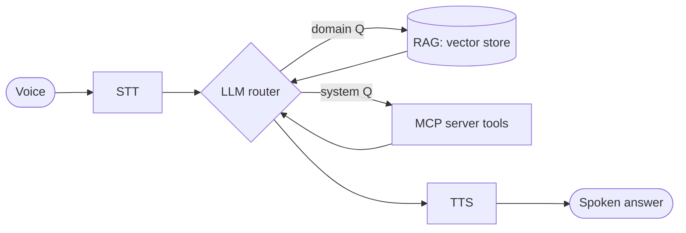

# AI Voice Agent

A voice-activated AI agent that answers by combining **RAG** (knowledge retrieval) and **MCP** (real-time tool execution), with a "phone call" web UI. Built in Python; the LLM and embeddings go through [OpenRouter](https://openrouter.ai). Speech-to-text uses the browser's Web Speech API by default, or an audio-capable OpenRouter model when `STT_MODE=openrouter`.

**Pipeline:** mic audio → STT → LLM decides (RAG and/or MCP tool) → tool result → LLM answer → TTS

- **RAG:** FAQ and product spec documents (`knowledge_base/`) are chunked, embedded and searched by cosine similarity.
- **MCP:** a standalone MCP server (`app/mcp_server.py`) exposes 5 tools: current time, safe calculator, live weather, system info, and log reader.
- **Voice UI:** hands-free call mode with silence detection, live waveform, barge-in, and a routing trace that shows which RAG / MCP step each answer used. A text box is available as fallback.

See [docs/HLD.md](docs/HLD.md) for the architecture diagram and design trade-offs.



## Prerequisites

- Python 3.12+ (on Apple Silicon, use a native arm64 Python; an x86_64/Rosetta build cannot compile the `cryptography` dependency)
- An OpenRouter API key: https://openrouter.ai/keys (some credit is needed for the paid models)
- **Chrome or Edge** for the UI (microphone + speech synthesis). Allow microphone access when asked.

## Setup (Windows PowerShell)

```powershell
git clone <your-repo-url> ai-voice-agent
cd ai-voice-agent

python -m venv .venv
.\.venv\Scripts\Activate.ps1
pip install -r requirements.txt

copy .env.example .env
notepad .env        # paste your OPENROUTER_API_KEY
```

### macOS / Linux

```bash
python3 -m venv .venv && source .venv/bin/activate
pip install -r requirements.txt
cp .env.example .env && nano .env
```

## Run

```bash
python -m app.main
```

Open **http://127.0.0.1:8000** and click **Start call**. Speak, pause, and the agent answers aloud. Click the orb while it speaks to interrupt it. Click **End call** to hang up.

On startup the app builds the vector index (cached in `data/`), launches the MCP server as a subprocess, and lists the discovered tools in the UI.

## Environment variables

| Variable | Required | Default | Purpose |
|---|---|---|---|
| `OPENROUTER_API_KEY` | yes | none | OpenRouter key for LLM, STT and embeddings |
| `LLM_MODEL` | no | `openai/gpt-4o-mini` | Chat model, or a comma-separated fallback list tried in order; must support tool calling |
| `STT_MODE` | no | `browser` | `browser` = free Web Speech API (Chrome/Edge); `openrouter` = audio model via OpenRouter (needs >= $0.50 credit) |
| `STT_MODEL` | no | `google/gemini-2.5-flash` | Audio-input model used for transcription |
| `EMBEDDING_MODEL` | no | `openai/text-embedding-3-small` | RAG embeddings (falls back to local TF-IDF if unavailable) |
| `COMPANY_NAME` | no | `Demo Wallet` | Business the assistant represents (used in the prompt and RAG tool description) |
| `COMPANY_DESCRIPTION` | no | `a digital money-management app` | One-line description of that business |
| `KB_TOPICS` | no | `plans, fees, limits, ...` | Topics the knowledge base covers; tells the LLM when to search it |
| `AGENT_NAME` | no | (none) | Optional name the assistant introduces itself with |
| `HOST` / `PORT` | no | `127.0.0.1` / `8000` | Server bind address |

## Try these queries

| Query | Route |
|---|---|
| "What are the transfer limits on the Plus plan?" | RAG |
| "What's the weather in Mumbai right now?" | MCP `get_weather` |
| "If I send 2,500 dollars abroad on the Premium plan, how much is the fee?" | RAG (0.4% fee) then MCP `calculate` |
| "What time is it in New York, and when does your phone support close?" | MCP `get_current_time` + RAG |

## Project layout

```
app/
  main.py          FastAPI server and API routes
  agent.py         Orchestrator: MCP client, LLM tool-calling loop, STT
  rag.py           Chunking, embeddings, vector store, search
  mcp_server.py    MCP server with the system tools
  config.py        Environment config
  static/          Web UI (index.html, style.css, app.js)
knowledge_base/    Fictional "Demo Wallet" sample FAQ + product specs (replace with your own .md/.txt)
docs/HLD.md        High-level design diagram + trade-offs
tests/             Offline tests (no API key needed)
```

## Customising

- **Use your own business:** replace the sample files in `knowledge_base/` and set `COMPANY_NAME`, `COMPANY_DESCRIPTION` and `KB_TOPICS` in `.env`.
- **Add knowledge:** drop `.md` / `.txt` files in `knowledge_base/` (use `## Heading` per topic) and restart. The index rebuilds automatically.
- **Add a tool:** add a function decorated with `@mcp.tool()` in `app/mcp_server.py` and restart. The agent discovers it automatically.
- **Debug the MCP server alone:** `npx @modelcontextprotocol/inspector python -m app.mcp_server`

## Development

```bash
pip install -r requirements-dev.txt   # production deps + pytest, ruff, mypy

ruff check .            # lint
ruff format .           # format
mypy                    # type-check (strict)
pytest                  # backend tests
```

Browser tests (Playwright, needs Node 20+):

```bash
npm ci
npx playwright install chromium
npx playwright test     # starts the server itself; LLM calls are stubbed
```

No test needs an API key or network access. The backend suite covers calculator safety, RAG retrieval ranking, the agent routing loop (scripted LLM, real MCP server over stdio) and the HTTP API. CI (`.github/workflows/ci.yml`) runs all of the above on every push and pull request.

`requirements.txt` pins exact production versions; `requirements-dev.txt` adds the tooling. Upgrade by editing a pin and re-running the full suite.

## Troubleshooting

- **402 "requires more credits"**: your OpenRouter balance is too low. Add credit at https://openrouter.ai/settings/credits ($5 lasts a long time with `gpt-4o-mini`), or set a free model in `.env`, e.g. `LLM_MODEL=google/gemma-4-31b-it:free` (rate-limited; pick another `:free` model with tool support if it errors).

- **"OPENROUTER_API_KEY is not set"**: create `.env` from `.env.example` and restart.
- **Speech-to-text failed (400/404)**: your `STT_MODEL` doesn't accept audio. Use `google/gemini-2.5-flash` or another model with audio input.
- **Mic button does nothing**: use Chrome/Edge on `localhost` and allow microphone permission. You can still type.
- **No spoken reply**: check that the "Voice on" toggle is enabled and the system volume is up.
- Logs are written to `logs/agent.log`, and the agent can read them through the `read_system_logs` tool ("any errors in the logs?").

## Demo video outline (3-5 min)

1. (0:00-2:00) Walk through `docs/HLD.md`: voice in, STT, LLM router, RAG vs MCP branches, TTS out. Explain the trade-offs.
2. (2:00-4:30) Live demo: ask the "2,500 dollars on Premium" question (RAG then MCP), then the weather and logs queries, and show the routing trace cards.
