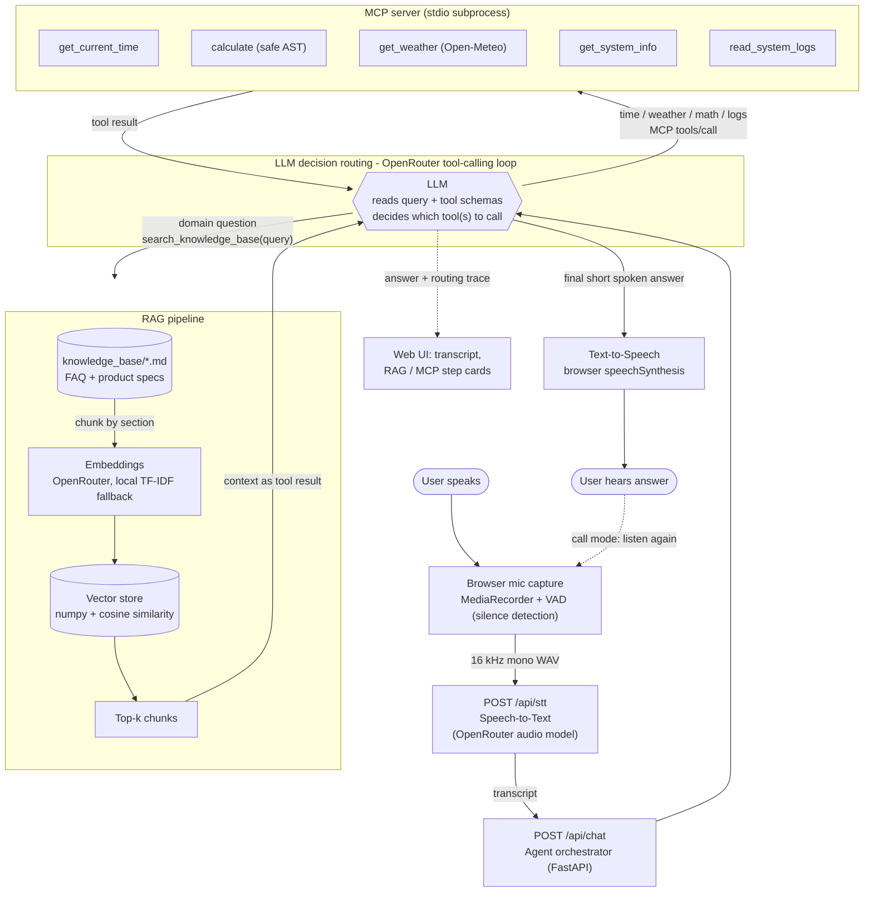

# High-Level Design

## Components

| Layer | File | Responsibility |
|---|---|---|
| Voice UI | `app/static/*` | Call UI, mic capture, VAD, WAV encoding, TTS playback, routing trace |
| API | `app/main.py` | `/api/stt`, `/api/chat`, `/api/status`, static files |
| Orchestrator | `app/agent.py` | MCP client, tool schema merge, LLM tool-calling loop, STT call |
| RAG | `app/rag.py` | Chunking, embeddings, persistent vector store, cosine search |
| MCP server | `app/mcp_server.py` | Five local tools exposed over the Model Context Protocol |

## Design decisions and trade-offs

1. **The LLM is the router.** RAG is exposed as just another tool next to the MCP tools. No hand-written intent classifier, so a query like *"fee for 2,500 USD abroad on Premium"* can chain RAG (fee rate) and then MCP `calculate` (exact maths). Trade-off: routing quality depends on the model and on clear tool descriptions.
2. **MCP over stdio subprocess.** The server is a real, standalone MCP server (`python -m app.mcp_server`) that any MCP client can use. The agent discovers tools at startup via `tools/list`, so adding a tool needs no agent change. Trade-off: one extra process.
3. **Own vector store (numpy) instead of Chroma/FAISS.** The corpus is tiny. A normalised matrix and one matmul gives exact cosine search, zero native dependencies, and it works on any Python version. Swap in a real vector DB past ~100k chunks.
4. **Embedding fallback.** If OpenRouter embeddings are unavailable, a local TF-IDF hashing embedder keeps retrieval working offline, at lower quality for paraphrases.
5. **STT via an audio-capable LLM on OpenRouter**, since OpenRouter has no dedicated Whisper endpoint. This keeps one API key and one vendor. Trade-off: higher latency than a streaming STT engine. The browser downsamples to 16 kHz WAV so any model accepting `input_audio` works.
6. **TTS in the browser (`speechSynthesis`).** Zero cost and zero latency to first audio. Trade-off: voice quality depends on the OS. Replaceable by a server TTS behind the same `speak()` function.
7. **Voice-first prompt.** The system prompt forces short, markdown-free replies, which sound natural when spoken, and keeps latency down.
8. **Safety.** The calculator parses with `ast` and a whitelist (no `eval`). The RAG prompt restricts answers to retrieved context to limit hallucination.
